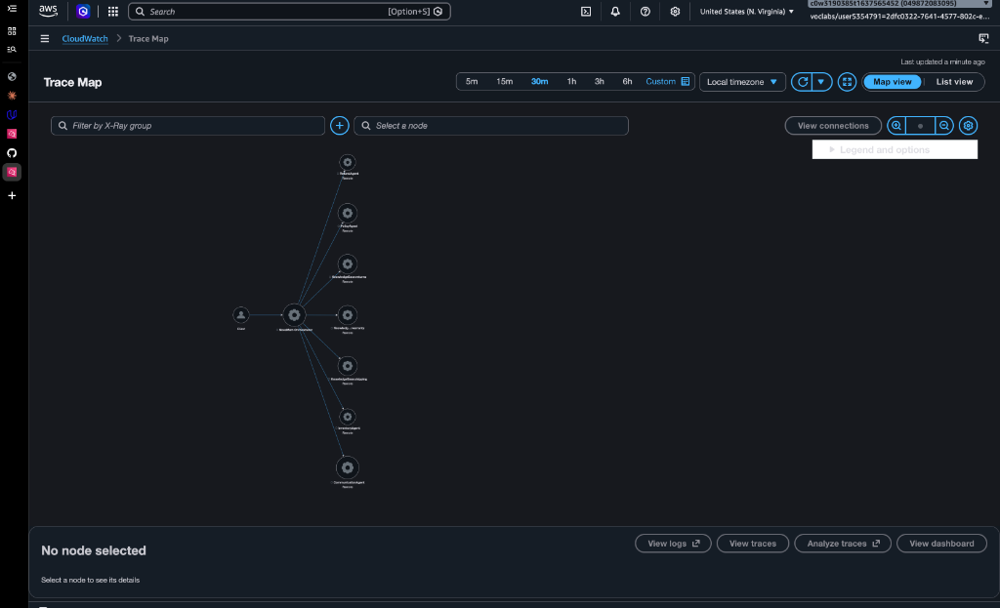

# NovaMart Multi-Agent Customer Support System
### Enterprise Multi-Agent Architecture with Amazon Bedrock AgentCore & Strands Agents SDK

[](https://aws.amazon.com/bedrock/)
[](https://strandsagents.com/)
[](https://www.python.org/)
[](https://aws.amazon.com/bedrock/claude/)
[-success?logo=checkmarx&logoColor=white)](#automated-evaluation-results-120--120-pts)
[](LICENSE)

An enterprise-grade, autonomous multi-agent customer support platform built for **NovaMart**, a large-scale e-commerce enterprise. The system leverages an **Orchestrator → Workers** hierarchy to handle complex customer interactions (order tracking, policy Q&A, return eligibility evaluation, and empathetic communication) with zero human intervention.

It features **parallel multi-agent RAG** across three Bedrock Knowledge Bases, **optimistic concurrency control** via DynamoDB, **Bedrock Guardrails** for content safety and PII masking, persistent **Session Memory**, and full end-to-end distributed observability via **AWS X-Ray** and **CloudWatch Logs**.

---

## Architecture Overview

<p align="center">
  
</p>

### The Agent Hierarchy

The system separates routing, reasoning, and policy retrieval into dedicated, least-privilege agent roles:

```text
                                Customer Request
                                       │
                                       ▼
                     ┌───────────────────────────────────┐
                     │         Orchestrator Agent        │
                     │         (Claude 4.5 Haiku)        │
                     │ • Intent Routing & State Machine  │
                     └─────────────────┬─────────────────┘
                                       │
         ┌─────────────────────────────┼─────────────────────────────┐
         ▼                             ▼                             ▼
┌──────────────────┐         ┌───────────────────┐         ┌──────────────────┐
│  InventoryAgent  │         │    PolicyAgent    │         │   RefundAgent    │
│(Claude 4.5 Sonnet│         │(Claude 4.5 Sonnet)│         │(Claude 4.5 Sonnet│
│  • Orders Table  │         │• Multi-Agent RAG  │         │ • Return Rules   │
│  • Customer Tier │         │  Coordinator      │         │ • Status Check   │
└──────────────────┘         └─────────┬─────────┘         └──────────────────┘
                                       │
                     ┌─────────────────┼─────────────────┐
                     ▼                 ▼                 ▼
             ┌───────────────┐ ┌───────────────┐ ┌───────────────┐
             │ReturnsRetriever ShippingRetrievr│ WarrantyRetrievr│
             │ (Bedrock KB)  │ │ (Bedrock KB)  │ │ (Bedrock KB)  │
             └───────────────┘ └───────────────┘ └───────────────┘
                     └───────── Parallel Execution ──────┘
                                       │
                                       ▼
                     ┌───────────────────────────────────┐
                     │        CommunicationAgent         │
                     │        (Claude 4.5 Sonnet)        │
                     │  • Empathetic Customer Response   │
                     └───────────────────────────────────┘
```

| Agent | LLM Foundation Model | Primary Responsibility | Associated Tools |
| :--- | :--- | :--- | :--- |
| **OrchestratorAgent** | Claude 4.5 Haiku | Request classification, agent delegation, and `WorkflowState` versioning | `initialize_session`, `route_to_inventory_agent`, `route_to_policy_agent`, `route_to_refund_agent`, `route_to_communication_agent` |
| **InventoryAgent** | Claude 4.5 Sonnet | Queries customer tiers and order statuses from DynamoDB | `check_order_status`, `get_customer_tier`, `list_customer_orders` |
| **PolicyAgent** | Claude 4.5 Sonnet | Coordinates concurrent retrieval sub-agents across multiple knowledge bases | `search_all_policies` (fans out to 3 parallel sub-agents) |
| **RefundAgent** | Claude 4.5 Sonnet | Evaluates return eligibility based on tier windows (30d Standard, 60d Premium) | `get_inventory_context`, `initiate_refund` |
| **CommunicationAgent**| Claude 4.5 Sonnet | Synthesizes final customer-facing responses with professional tone | `get_full_workflow_context` |

<p align="center">
  
</p>

---

## Live Distributed Tracing & Observability (AWS X-Ray)

Every request moving through the orchestrator generates an AWS X-Ray distributed trace. The system traces the client call through the Orchestrator, across all worker agents, down to individual Bedrock Knowledge Base queries.

### Verified AWS CloudWatch X-Ray Service Map
The trace map below shows the live execution of an end-to-end request passing through `NovaMart-Orchestrator`, worker agents (`InventoryAgent`, `RefundAgent`, `PolicyAgent`, `CommunicationAgent`), and parallel Bedrock Knowledge Bases (`returns`, `shipping`, `warranty`):

<p align="center">
  
</p>

- **Trace Segment Destination**: `CloudWatchLogs` (Transaction Search Active)
- **Sampling Rate**: 100% rule-based capture for real-time debugging and SLA monitoring
- **Log Stream**: Integrated with `/aws/bedrock/agentcore/udacity-agentcore`

---

## Key Technical Features

### 1. Parallel Multi-Agent RAG
Instead of overloading a single knowledge base or performing sequential searches, the **PolicyAgent** decomposes policy queries and executes three specialized sub-agents concurrently via `concurrent.futures.ThreadPoolExecutor`:
- `ReturnsPolicyRetriever` (`RETURNS_KB_ID`)
- `ShippingPolicyRetriever` (`SHIPPING_KB_ID`)
- `WarrantyPolicyRetriever` (`WARRANTY_KB_ID`)

Each sub-agent queries its respective Amazon Bedrock Knowledge Base (backed by S3 Vectors and `amazon.titan-embed-text-v2:0`), returning ranked passages that the PolicyAgent synthesizes into unified policy facts.

### 2. DynamoDB Shared WorkflowState with Optimistic Locking
Agents collaborate asynchronously through a centralized `WorkflowStateTable` in DynamoDB. To prevent race conditions and overwriting between concurrent agents:
- Each state update checks `expected_version` against the current database item `version`.
- Updates execute with conditional expressions: `ConditionExpression="attribute_not_exists(version) OR version = :v"`.
- If a conflict occurs, optimistic locking ensures state integrity and enables automatic retries.

### 3. Bedrock Guardrails Enterprise Safety
Enterprise safety is enforced on the deployed runtime via Amazon Bedrock Guardrails:
- **Content Filters**: Blocks hate speech, insults, sexual content, and violence at HIGH strength.
- **PII Redaction**: Automatically masks sensitive entities (Credit Card numbers, SSNs, Passwords, API keys).
- **Prompt Attack Filter**: Defends against prompt injection and jailbreak attempts.
- **Topic Denial**: Blocks inquiries regarding competitors, investment advice, or internal system configurations.

### 4. AgentCore Persistent Session Memory
- Context is retained across multi-turn user dialogues using Bedrock AgentCore Memory.
- Configured with `summaryMemoryStrategy` and a 7-day event retention window.
- Enables the agent to remember user preferences, prior order lookups, and customer context without re-querying backend storage.

---

## Automated Evaluation Results (120 / 120 pts)

The test suite validates compliance, multi-agent coordination, Knowledge Base synchronization, guardrail enforcement, and distributed observability:

```text
======================================================================
  NovaMart Multi-Agent Customer Support Validation Suite
======================================================================

Task 2: Multi-Agent Orchestration                     [40 / 40 pts]  ✓ PASS
  • build_inventory_agent() returns Agent with 3 tools  (+10 pts)
  • build_policy_agent() returns Agent with 1 tool      (+10 pts)
  • build_orchestrator_agent() with 5 routing tools    (+10 pts)
  • Model configurations (Haiku for routing, Sonnet)    (+10 pts)

Task 3: AgentCore Deployment & Guardrails             [20 / 20 pts]  ✓ PASS
  • Bedrock Guardrail exists & policies match specs     (+10 pts)
  • Guardrail version 1 published and READY              (+3 pts)
  • AgentCore Runtime READY (PUBLIC / HTTP)              (+7 pts)

Task 4: Persistent Session Memory                     [15 / 15 pts]  ✓ PASS
  • AgentCore Memory resource is ACTIVE                  (+5 pts)
  • SESSION_SUMMARY strategy configured                  (+5 pts)
  • 7-day event retention duration configured            (+5 pts)

Task 5: Bedrock Knowledge Bases & Parallel RAG        [25 / 25 pts]  ✓ PASS
  • Returns, Shipping, Warranty KBs ACTIVE & synced     (+15 pts)
  • Titan Embed Text v2 vector storage confirmed         (+5 pts)
  • Concurrent multi-agent retrieval verified            (+5 pts)

Task 6: CloudWatch Observability & Tracing            [20 / 20 pts]  ✓ PASS
  • CloudWatch logging enabled at INFO level            (+10 pts)
  • X-Ray tracing enabled at 100% sampling rate         (+10 pts)
  • Trace segments received and verified in X-Ray        (ACTIVE)
──────────────────────────────────────────────────────────────────────
  TOTAL SCORE:                                        [120 / 120 pts] 100%
======================================================================
```

---

## Project Structure

```text
novamart-multi-agent-support/
├── src/
│   ├── agent_orchestrator.py      # Core Orchestrator & worker agent definitions
│   ├── agent_observability.py     # AWS X-Ray tracing & CloudWatch log configuration
│   ├── agent_utils.py             # DynamoDB state helpers & session initialization
│   ├── agentcore_cli.py           # Wrapper for AgentCore CLI packaging & CDK deployment
│   └── bedrock_kb_retrieval.py    # Multi-threaded parallel Bedrock KB retriever
├── config.py                      # Centralized configuration & AWS resource resolvers
├── infrastructure/
│   ├── cloudformation.yaml        # Infrastructure stack (DynamoDB, S3, IAM, S3 Vectors)
│   ├── seed_data.py               # Seed script for sample orders, customers & policies
│   └── cleanup.py                 # Automated teardown script for AWS resources
├── diagrams/
│   ├── architecture-overview.png  # System architecture graphic
│   ├── agents-and-tools-reference.png # Detailed agent/tool matrix
│   ├── request-flow-scenarios.png # Flowchart of request routing
│   └── xray-trace-map.png         # Live AWS X-Ray Service Map trace screenshot
├── evidence/
│   └── required/
│       ├── 01-tests-all-120.png   # Full test pass evidence
│       └── 02-xray-service-map.png# Live X-Ray trace map evidence
├── tests/
│   └── test_agent.py              # Automated 120-point validation suite
├── agentcore/                     # AgentCore CDK and runtime configuration
├── pyproject.toml                 # Project metadata & Python dependencies
└── requirements.txt               # Required Python packages
```

---

## Setup & Deployment Guide

### Prerequisites
1. **Python 3.12** environment.
2. **Node.js 20+** and **uv** installed.
3. **AgentCore CLI**:
   ```bash
   npm install -g @aws/agentcore@0.30.0
   ```
4. Configured AWS credentials with permissions for Bedrock, CloudFormation, DynamoDB, S3, and CloudWatch.

### 1. Install Python Dependencies
```bash
python3 -m venv .venv
source .venv/bin/activate
pip install -r requirements.txt
```

### 2. Configure Environment Variables
Create a `.env` file from `.env.example`:
```bash
cp .env.example .env
```
Populate the resource IDs (Knowledge Bases, Guardrail ID, Runtime ARN):
```ini
AWS_REGION=us-east-1
PROJECT_NAME=udacity-agentcore

RETURNS_KB_ID=<your-returns-kb-id>
SHIPPING_KB_ID=<your-shipping-kb-id>
WARRANTY_KB_ID=<your-warranty-kb-id>

GUARDRAIL_ID=<your-guardrail-id>
GUARDRAIL_VERSION=1
AGENTCORE_RUNTIME_ARN=<your-runtime-arn>
```

### 3. Deploy to Amazon Bedrock AgentCore Runtime
Run the deployment pipeline:
```bash
python3 src/agent_orchestrator.py deploy
```
This performs direct code packaging with `uv`, synthesizes CDK infrastructure, deploys the runtime stack `AgentCore-udacity-default`, attaches guardrails, and configures CloudWatch/X-Ray observability.

### 4. Run the Full Test Suite
```bash
python3 tests/test_agent.py all
```

### 5. Interactive Testing & Runtime Invocations
- **Test Pre-built Scenarios Locally**:
  ```bash
  python3 src/agent_orchestrator.py test
  ```
- **Invoke the Live Deployed Cloud Runtime**:
  ```bash
  python3 src/agent_orchestrator.py invoke "I want to return order ORD-27176"
  ```
- **Start an Interactive Terminal Chat Session**:
  ```bash
  python3 src/agent_orchestrator.py chat
  ```

---

## License

This project is licensed under the MIT License - see the [LICENSE](LICENSE) file for details.
